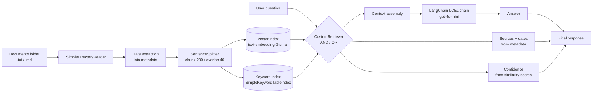

# DataPulse RAG: Hybrid Retrieval Assistant for Internal Company Knowledge

> A Retrieval-Augmented Generation (RAG) prototype that answers natural-language questions about a company's internal documentation, with **traceable sources**, a **confidence level**, and the **validity date** of every source.


---

## Table of contents

1. [Project overview](#1-project-overview)
2. [Objectives](#2-objectives)
3. [Architecture](#3-architecture)
4. [Methodology, step by step](#4-methodology-step-by-step)
5. [Output format](#5-output-format)
6. [How to run](#6-how-to-run)
7. [Project status and known limitations](#7-project-status-and-known-limitations)
8. [Repository layout](#8-repository-layout)
9. [Tech stack](#9-tech-stack)

---

## 1. Project overview

**DataPulse S.p.A.** is a fictional mid-sized tech company in the financial sector. Its internal knowledge is spread across heterogeneous documents: operating manuals, compliance policies, project reports, technical emails, FAQs and product knowledge bases.

This project is a Python backend that lets employees query that documentation in plain language. For example:

> *"What is the updated procedure for customer data access requests, and which regulations must we comply with?"*

The system retrieves the relevant passages, generates a concise answer with an LLM, and attaches the evidence needed to trust it.

The work was developed as a course project for an AI Solution Architect program. It started as a Google Colab notebook (`DataPulse.ipynb`); this README documents it for readers who have not seen the notebook.

## 2. Objectives

| # | Requirement | How it is addressed |
|---|-------------|---------------------|
| 1 | **Ingestion** of plain-text documents, keeping essential metadata (date, origin) | `SimpleDirectoryReader` + a date extracted from each document's text |
| 2 | **Indexing** for efficient retrieval on text and metadata | Vector index and keyword index sharing one `StorageContext` |
| 3 | **Hybrid retrieval** combining semantic relevance and exact-term signals | Custom retriever with `AND` / `OR` fusion modes |
| 4 | **Generation** of concise answers from retrieved context | LangChain LCEL chain (`PromptTemplate` → LLM → `StrOutputParser`) |
| 5 | **Traceability**: sources and confidence on every answer | Computed in Python from node metadata and scores, **not** asked of the LLM |

## 3. Architecture



**Design choice worth noting:** the LLM is asked for the answer text *only*. The list of sources, their dates and the confidence label are built deterministically in Python from the retrieved nodes, so they cannot be hallucinated.

## 4. Methodology, step by step

### 4.1 Setup

The notebook uses OpenAI for both embeddings and generation, configured through LlamaIndex's global `Settings`.

```python
from langchain_openai.chat_models import ChatOpenAI
from llama_index.embeddings.openai import OpenAIEmbedding

model = ChatOpenAI(
    model_name="gpt-4o-mini",
    api_key=os.environ["OPENAI_API_KEY"],   # read from the environment, never hard-coded
)

Settings.embed_model = OpenAIEmbedding(model="text-embedding-3-small")
```

### 4.2 Ingestion and metadata

All files in the documents folder are loaded in one call. Each loaded `Document` already carries filesystem metadata such as `file_name`.

```python
folder = "/content/drive/MyDrive/LLM/Datapulse project/Documents"
documents = SimpleDirectoryReader(folder).load_data()
```

The validity date of each document is read from the text itself. Source documents contain a line in the form `**Data:** YYYY-MM-DD` (`Data` is the Italian word for "date", as the sample documents are in Italian). The date is stored in the document metadata:

```python
for doc in documents:
    after_date = doc.text.split("**Data:**")[1]   # text after the date marker
    date = after_date.split("\n")[0]              # keep only that line
    doc.metadata["date"] = date.strip()
```

### 4.3 Chunking

Documents are split into small, sentence-aware chunks. Short chunks suit short corporate documents and reduce the chance of mixing unrelated topics in one chunk.

```python
Settings.node_parser = SentenceSplitter(chunk_size=200, chunk_overlap=40)
nodes = Settings.node_parser.get_nodes_from_documents(documents)
```

### 4.4 Hybrid indexing

Two indexes are built on the **same** `StorageContext`, so the chunks are stored once and shared:

- **Vector index**: semantic similarity (finds passages with the same *meaning*).
- **Keyword index**: exact term matching (finds precise strings such as "article 15" that embeddings may blur).

```python
storage_context = StorageContext.from_defaults()
storage_context.docstore.add_documents(nodes)

vector_index  = VectorStoreIndex(nodes, storage_context=storage_context)
keyword_index = SimpleKeywordTableIndex(nodes, storage_context=storage_context)
```

Order matters: split into nodes first, register them in the docstore, then build both indexes on that shared context.

### 4.5 Custom hybrid retriever

A `BaseRetriever` subclass queries both retrievers and fuses the results by chunk ID:

| Mode | Behaviour | Trade-off |
|------|-----------|-----------|
| `AND` | Keeps only chunks found by **both** retrievers (intersection) | Conservative, high precision, may return nothing |
| `OR` | Keeps chunks found by **either** retriever (union) | Exhaustive, more recall, more noise |

```python
class CustomRetriever(BaseRetriever):
    def __init__(self, vector_retriever, keyword_retriever, mode="AND"):
        self._vector_retriever = vector_retriever
        self._keyword_retriever = keyword_retriever
        if mode not in ("AND", "OR"):
            raise ValueError("Invalid mode.")
        self._mode = mode
        super().__init__()

    def _retrieve(self, query_bundle: QueryBundle) -> List[NodeWithScore]:
        vector_nodes  = self._vector_retriever.retrieve(query_bundle)
        keyword_nodes = self._keyword_retriever.retrieve(query_bundle)

        vector_ids  = {n.node.node_id for n in vector_nodes}
        keyword_ids = {n.node.node_id for n in keyword_nodes}

        combined = {n.node.node_id: n for n in vector_nodes}
        combined.update({n.node.node_id: n for n in keyword_nodes})

        ids = vector_ids & keyword_ids if self._mode == "AND" else vector_ids | keyword_ids
        return [combined[i] for i in ids]
```

### 4.6 Answer generation (LangChain LCEL)

Retrieved chunks are joined into a context string and injected into a prompt that restricts the model to that context.

The original prompt is in Italian; its English equivalent is:

```text
You are the corporate assistant of DataPulse S.p.A.
Answer the user's question using only the following context: ```{context}```
Question: ```{question}```
```

```python
chain = prompt | model | StrOutputParser()

final_chain = (
    {"context": runnable_context, "question": runnable_question}
    | RunnablePassthrough.assign(final_answer=chain)
)

result = final_chain.invoke({"context": context, "question": question})
```

`RunnablePassthrough.assign()` keeps the existing keys of the dictionary and adds a new computed one, which makes it easy to append further steps (for example a safety check) without rewriting the pipeline.

### 4.7 Sources, dates and confidence

Sources and their dates come straight from node metadata. The confidence label maps the **average similarity score** of the retrieved nodes onto three levels:

```python
def calculate_confidence(results):
    avg_score = sum(r.score for r in results) / len(results)
    if avg_score >= 0.85:
        return "High score"
    elif 0.65 < avg_score < 0.85:
        return "Medium score"
    else:
        return "Low score"

sources = list({r.node.metadata.get("file_name") for r in results})
```

| Average score | Confidence |
|---------------|-----------|
| ≥ 0.85 | High |
| 0.65 to 0.85 | Medium |
| ≤ 0.65 | Low |

### 4.8 From notebook cells to a single class

All the steps above are consolidated into a `Main` class. Construction performs ingestion, date extraction, chunking, indexing and retriever setup; `ask()` runs retrieval, generation and the traceability layer.

```python
class Main:
    def __init__(self, documents: str): ...
    def ask(self, question: str) -> dict: ...
```

## 5. Output format

`ask()` returns a dictionary with three keys:

```python
{
    "answer": "<concise answer generated by the LLM>",
    "confidence": "<High score | Medium score | Low score>",
    "source and date": {"<file_name>": "<YYYY-MM-DD>", ...},
}
```

Example questions used in the notebook (translated from Italian):

1. *Are there exceptions to the customer data access request?*
2. *What is the updated procedure for customer data access requests, and which regulations must we comply with?*
3. *What is the procedure to adopt with new customers?*

## 6. How to run

### Option A: Google Colab

1. Upload `DataPulse.ipynb` to Colab.
2. Put your documents in a Drive folder and set `folder` to that path.
3. Store your OpenAI key in **Colab Secrets** under the name `OPENAI_API_KEY`, then load it:
   ```python
   import os
   from google.colab import userdata
   os.environ["OPENAI_API_KEY"] = userdata.get("OPENAI_API_KEY")
   ```
4. Mount Drive when prompted, then run all cells from top to bottom.

### Option B: Local machine

```bash
# 1. Clone and enter the repository
git clone https://github.com/<your-username>/datapulse-rag.git
cd datapulse-rag

# 2. Create a virtual environment and install dependencies
python -m venv .venv
source .venv/bin/activate          # Windows: .venv\Scripts\activate
pip install -r requirements.txt

# 3. Provide your API key through the environment
export OPENAI_API_KEY="your-key-here"   # Windows (PowerShell): $env:OPENAI_API_KEY="your-key-here"

# 4. Add documents to ./documents (see format below), then run the notebook
jupyter notebook DataPulse.ipynb
```

When running locally, skip the `drive.mount(...)` cell and point `folder` to `./documents`.

### Document format

Each document must contain a line with the validity date in this exact form, because the date extractor splits on it:

```text
**Data:** 2026-01-15
```

> **Security note:** never commit API keys. Always read them from environment variables or a secrets manager.

## 7. Project status and known limitations

This is a **prototype**. Being explicit about its state:

- **No saved results.** The notebook was saved before a complete end-to-end run: the Google Drive mount failed in the last recorded session, so the retrieval and generation cells have no stored outputs. Run it once to produce your own results.
- **Possible `None` scores in the confidence calculation.** In the fusion step, keyword-retriever nodes overwrite vector nodes with the same ID, and keyword nodes may carry no similarity score. If so, `calculate_confidence` would fail on those nodes. Worth verifying and, if confirmed, keeping the vector node's score for shared IDs.
- **`AND` mode can return nothing.** If no chunk is found by both retrievers, the context is empty. A fallback to `OR` is a natural improvement.
- **Curly braces in retrieved text.** Passing retrieved text through `PromptTemplate.from_template()` treats `{...}` as template variables. Documents containing braces could break the chain; passing the context as a plain input value avoids this.
- **Fixed date marker.** Date extraction assumes the `**Data:**` line exists in every document and raises an error otherwise.
- **Dependency warning on Colab.** The install step prints a version conflict with a preinstalled package (`google-adk` vs. newer OpenTelemetry). It did not block the install.
- **Unused imports.** `seaborn`, `matplotlib`, `numpy`, `pandas`, `sentence-transformers`, `chromadb` and the LangChain text splitters are imported but not used by the pipeline above.

### Possible next steps

- Convert the notebook to a standalone Python script with a `__main__` entry point.
- Persist the vector store (e.g. ChromaDB) so the index survives restarts.
- Add evaluation (precision@k, recall@k, or RAGAS faithfulness and answer relevancy) on a small question set.
- Add metadata filtering by date to prefer the most recent policy version.

## 8. Repository layout

```text
datapulse-rag/
├── DataPulse.ipynb      # original Colab notebook
├── README.md            # this file
├── requirements.txt     # Python dependencies
└── documents/           # your .txt / .md source documents (not included)
```

## 9. Tech stack

| Layer | Tool |
|-------|------|
| Ingestion, chunking, indexing, retrieval | LlamaIndex |
| Prompting and generation pipeline | LangChain (LCEL) |
| LLM | OpenAI `gpt-4o-mini` |
| Embeddings | OpenAI `text-embedding-3-small` |
| Environment | Google Colab / Python 3.10+ |
